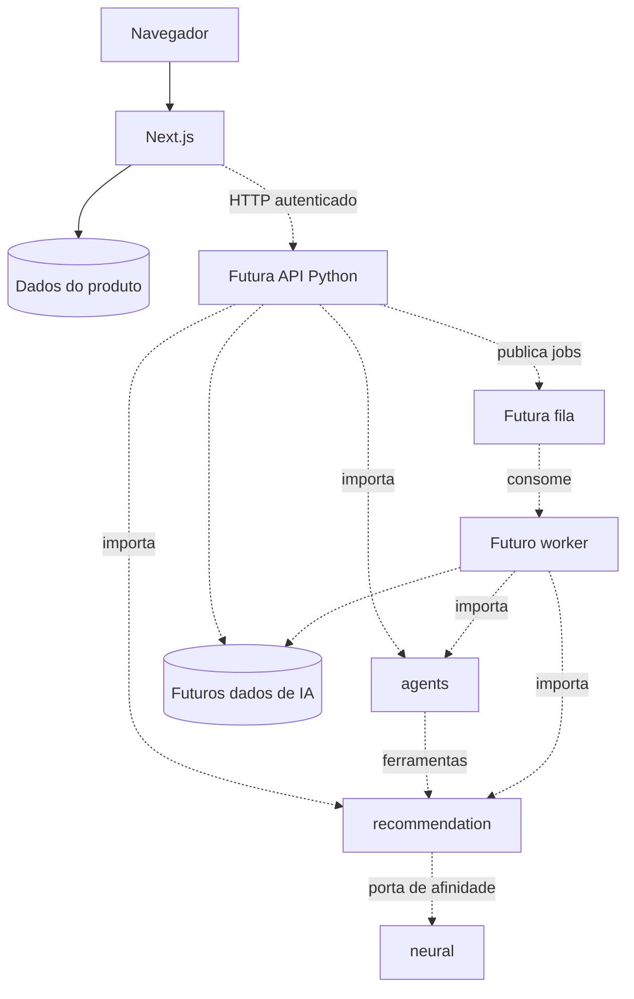
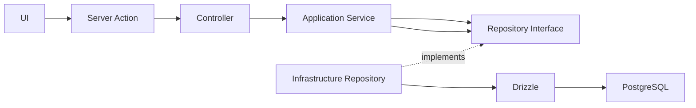

# Arquitetura do RatatouilleAI

## Estado atual e destino

O monorepo contém um web-app Next.js funcional em `apps/web`. API Python, worker,
agentes, recomendação e rede neural são somente pastas documentadas. Não existem
integrações de IA, endpoints Python, modelo treinado, broker ou pgvector ativos.

```text
apps/
  web/          Next.js, interface e backend do produto
  ai-api/       Futuro FastAPI
  ai-worker/    Futuros jobs assíncronos
packages/
  agents/       NutriGuard, Chef Regional, workflows, ferramentas e LLM
  recommendation/  Filtros, políticas, ranking e validação alimentar
  neural/       Features, treinamento, inferência e avaliação
  ai-client/    Futuro cliente TypeScript gerado
contracts/      Futuro OpenAPI exportado e contratos de eventos
infra/docker/   Infraestrutura futura de IA
scripts/        Automação futura
```

## Comunicação e dependências



Linhas pontilhadas representam integrações ainda não implementadas. Aplicações se
comunicam por HTTP ou fila. Pacotes Python são dependências instaláveis explícitas;
TypeScript não importa arquivos Python. API e worker conectam as implementações às
interfaces dos pacotes. `neural` não depende de `agents`, FastAPI ou Next.js.

No web-app, criar futuramente `AiGateway` em `application/ports` e o adaptador HTTP
em `infrastructure/ai`. Consumir o cliente TypeScript somente no backend. Manter
segredos dos provedores no Python. Autenticação entre serviços deve propagar uma
identidade verificada e cada consulta deve autorizar o acesso ao recurso.

## Fluxos previstos

1. O Next.js salva perfil, região e preferências e envia um snapshot autenticado e
   versionado à API de IA.
2. O backend aplica políticas obrigatórias e recupera candidatos do catálogo.
3. O ranking usa preferências, diversidade e afinidade neural quando disponível.
4. O Chef Regional propõe um plano com IDs de catálogo e porções estruturadas.
5. A validação em código verifica ingredientes e totais antes da persistência.
6. O NutriGuard pode auxiliar e explicar; sua resposta não substitui políticas.
7. O web-app consulta execuções demoradas por ID; streaming pode ser adicionado.

Na troca de um item, preservar os demais itens e revalidar refeição e totais
relevantes do plano. Usar versão do plano para impedir sobrescrita concorrente.
Correções têm tentativas limitadas; a falta de candidatos válidos deve ser explícita.

## Dados e responsabilidade

Inicialmente pode haver uma instância PostgreSQL com schemas e permissões separados.
O Next.js/Drizzle continua dono de usuários, perfil e preferências. O backend Python
será dono de catálogo, planos, execuções e feedback, com migrações próprias. Não usar
dois mecanismos de migração para as mesmas tabelas. Alterações de restrições devem
invalidar ou exigir revalidação de planos e snapshots anteriores.

Preferências flexíveis podem usar JSONB. Restrições críticas e ingredientes precisam
de estrutura validável. Busca vetorial é opcional e não comprova equivalência
nutricional. O catálogo precisa tratar informações desconhecidas; SQL não garante
segurança quando os dados estão incompletos. Especificar regras com responsáveis
do domínio antes de utilizá-las em recomendações reais.

Registrar exposição, escolha, troca e avaliação como eventos distintos. Uma troca
não equivale automaticamente a rejeição. Treinamento será offline e versionado;
inferência usa um modelo publicado. Sem dados suficientes, usar baseline por regras.
Pesos e datasets grandes ficam em armazenamento externo, com referências de versão.
Minimizar dados pessoais enviados aos modelos e evitar registrá-los em logs.

## Ferramentas e contratos futuros

pnpm administra o workspace TypeScript. Quando houver código Python, criar projetos
com `pyproject.toml` e configurar uv com lockfile; não há configuração Python fictícia
nesta etapa. O modelo pode ter ambiente próprio se as dependências forem incompatíveis.

Os schemas da API serão a origem do OpenAPI em `contracts/`, do qual será gerado o
cliente em `packages/ai-client`. A CI deverá detectar divergências. Fila e worker
precisarão de persistência de progresso, idempotência, timeout e retries limitados.
Um serviço separado de inferência só será necessário conforme hardware e escala.

## Arquitetura interna atual do web-app

Os caminhos abaixo são relativos a `apps/web`.

The backend follows Clean Architecture. `domain` owns entities, value objects, errors, and repository contracts. `application` orchestrates domain objects. `infrastructure` implements technical concerns such as Drizzle and PostgreSQL. `presentation` adapts validated input to application services. `composition-root.ts` creates concrete dependencies.



Frontend components use Atomic Design: atoms are reusable primitives, molecules compose atoms, organisms compose larger shared sections, and `features` own product-specific UI. Client features call Server Actions; they never import infrastructure or access the database.

Allowed imports: application → domain; infrastructure → application/domain; presentation → application/domain types. Forbidden imports include domain → Next.js/Drizzle/React, application → PostgreSQL, and frontend → infrastructure. Create an abstraction only when two real consumers need the same stable contract.

Server Action flow: form → Zod validation → controller → application service → repository interface → Drizzle implementation. Drizzle schemas live in infrastructure and migrations are generated into `apps/web/drizzle/`.
