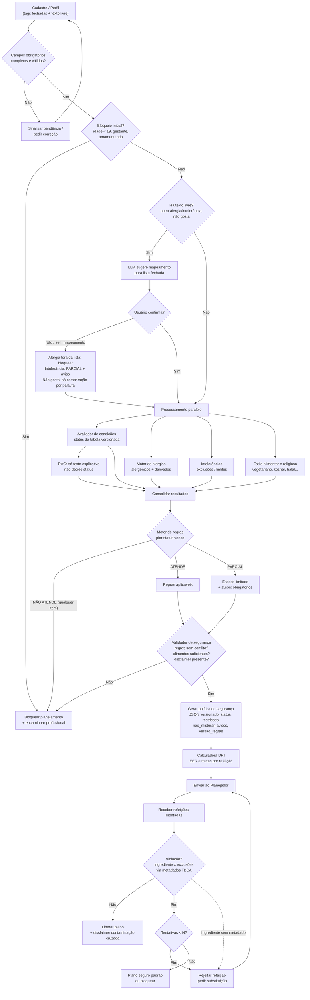

# Fluxo do Guardião (revisado)

## Mudanças em relação ao fluxo original

1. Bloqueios iniciais (idade, gestação, amamentação) antes do processamento.
2. LLM só mapeia texto livre para lista fechada; usuário confirma; LLM não decide status.
3. Status das condições vem da tabela versionada (planilha); RAG só explica.
4. Intolerâncias e estilo alimentar ganham caminho próprio.
5. Qualquer NÃO ATENDE bloqueia; pior status vence.
6. Validador de segurança com critérios explícitos.
7. PARCIAL gera escopo limitado com avisos obrigatórios.
8. Loop de substituição com limite de tentativas.
9. Ingrediente sem metadado de alergênico é tratado como violação.
