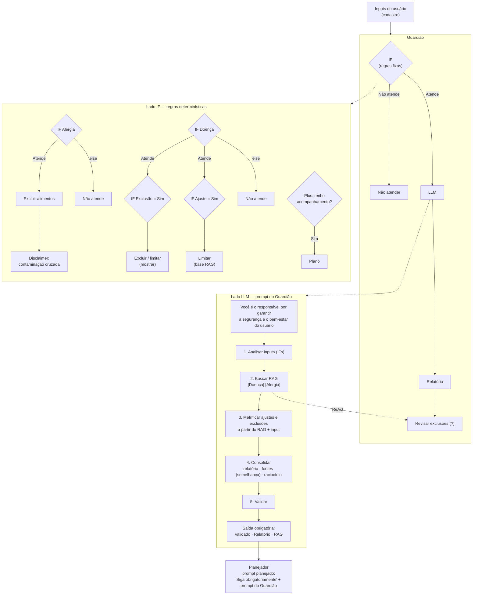

# Guardião — transcrição da lousa 1

Diagrama fiel ao que está desenhado na lousa. Trechos com leitura incerta estão marcados com `(?)`.

## Leitura da lousa

| Parte | O que diz |
|---|---|
| Centro | Guardião → IF (se não atende, para) → LLM → relatório → revisar exclusões |
| Direita (IF) | Alergia: excluir + disclaimer ou não atende. Doença: exclusão e/ou ajuste (limitar com base no RAG) ou não atende. Plus: com acompanhamento profissional → plano |
| Esquerda (LLM) | Papel, 5 funções e saída obrigatória (Validado, Relatório, RAG) |
| Rodapé | Planejador recebe prompt planejado + "siga obrigatoriamente" + prompt do Guardião |

Leituras incertas:
- "Revisar exclusões", em vermelho no centro.
- "O Dr. Gatinho / RAG", ao lado de "Limitar"; interpretado como base RAG.
- Ligação do "ReAct": seta do RAG para o bloco central.
